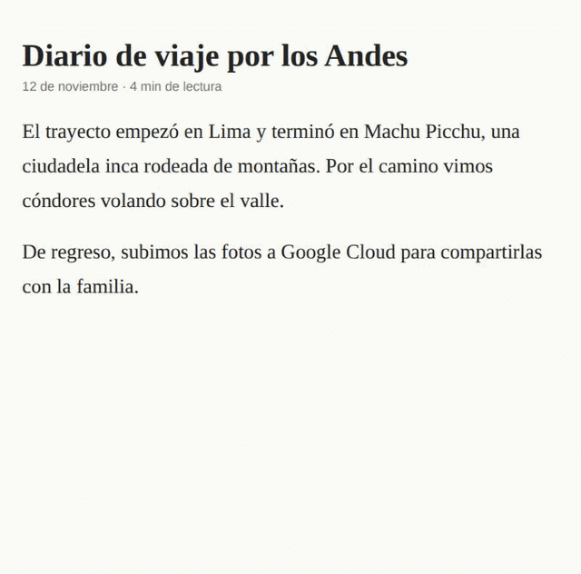

# 🔎 WhatDis

Extensión de Chrome/Brave que muestra una **tarjeta de vista previa de Wikipedia** al dejar el cursor sobre una palabra concreta de cualquier página (un animal, un lugar, una tecnología, una persona…). Sin hacer clic, sin salir de la página.



## Qué hace

- Detecta la palabra bajo el cursor tras 400 ms quieto y la busca en Wikipedia (español o inglés).
- Muestra una tarjeta con título, imagen, extracto y enlace al artículo.
- Entiende **plurales** (`cóndores` → Cóndor, `cities` → City) y **frases con mayúscula** de 2 o 3 palabras (`Google Cloud`, `Machu Picchu`, `New York`).
- Si la palabra es ambigua (`Azure`, `Docker`), muestra una **lista de significados** enlazados.
- Ignora lo que no es un concepto: conectores, palabras cortas, números, verbos conjugados evidentes y texto dentro de `input`, `textarea`, `pre`, `code` o campos editables.
- No se activa mientras seleccionas texto. La tarjeta se cierra con `Esc`, al hacer scroll, al hacer clic fuera o al alejar el cursor.

## Instalación

No está en la Chrome Web Store. Se carga como extensión sin empaquetar:

1. Descarga o clona este repositorio.
2. Abre `chrome://extensions` (en Brave, `brave://extensions`).
3. Activa el **Modo de desarrollador**.
4. Pulsa **Cargar descomprimida** y elige la carpeta del proyecto.

Después de cambiar el código, pulsa ⟳ en la tarjeta de la extensión y recarga las pestañas abiertas.

## Ajustes

Desde el icono de la barra de herramientas (o el engranaje ⚙ de la tarjeta):

- **Activar WhatDis**: se aplica al instante, sin recargar la página.
- **Idioma**: *Automático* (usa el atributo `lang` de la página: español si empieza por `es`, si no inglés), *Español* o *English*. Útil en páginas que declaran un idioma distinto al del texto, como claude.ai.

## Privacidad

- La única petición de red es a `es.wikipedia.org` o `en.wikipedia.org`, y solo contiene la palabra (o frase) sobre la que dejas el cursor.
- No hay analítica, cuentas ni claves de API. La extensión no envía el texto de la página a ningún otro servidor.
- Los resultados se guardan 7 días en `chrome.storage.local` (incluidas las palabras sin artículo, para no repetir consultas). Los ajustes también son locales.
- Permisos: `storage` y acceso a `https://*.wikipedia.org/*`. El script de contenido se ejecuta en todas las páginas para detectar la palabra, pero solo lee texto bajo el cursor.

## Cómo funciona

```
content.js  ──mensaje "lookup"──▶  background.js  ──fetch──▶  API REST de Wikipedia
 (detecta la palabra,               (variantes de plural,       /page/summary/{título}
  filtros, tarjeta                   frases, caché, lista de     /w/api.php (significados)
  en Shadow DOM)                     significados)
```

```
manifest.json   Manifest V3
background.js   Service worker: búsqueda en Wikipedia, plurales, frases y caché
content.js      Palabra bajo el cursor, filtros y tarjeta (Shadow DOM cerrado)
popup.html/.js  Ajustes (activar e idioma)
icons/          Iconos 16, 48 y 128
docs/           Demostración
```

JavaScript plano, sin dependencias ni empaquetadores. La tarjeta se construye solo con `textContent` (nunca `innerHTML`) y vive en un Shadow DOM cerrado para que los estilos de la página no la afecten.

## Limitaciones conocidas

- Solo busca en Wikipedia en español e inglés. No hay IA ni explicaciones generadas.
- Las frases solo se detectan con todas las palabras en mayúscula inicial. `machine learning` en minúsculas se busca palabra por palabra.
- Los verbos en presente de tercera persona (`corre`, `quiere`) no se pueden distinguir de un sustantivo y pueden mostrar una tarjeta.
- Si Wikipedia redirige una palabra a otro artículo, la tarjeta muestra el título del artículo destino (`perro` → *Canis familiaris*).
- Algunas palabras comunes con mayúscula al inicio de una frase (`Grande`) pueden mostrar una lista de significados.
- Solo Chrome y Brave (Manifest V3). No hay versión para Firefox.

## Licencias y atribución

- El **código** de WhatDis se distribuye bajo la licencia [MIT](LICENSE).
- El **contenido** de las tarjetas proviene de [Wikipedia](https://www.wikipedia.org/) y está disponible bajo la licencia [CC BY-SA 4.0](https://creativecommons.org/licenses/by-sa/4.0/). Cada tarjeta enlaza al artículo original y a la licencia.

## Ideas futuras

No están en el alcance actual:

- Explicaciones con un modelo de lenguaje (con modos como "explícamelo fácil") usando una clave de API propia.
- Detección según el contexto de la frase para elegir el significado correcto.
- Frases en minúscula (`machine learning`).
- Versión para Firefox.
